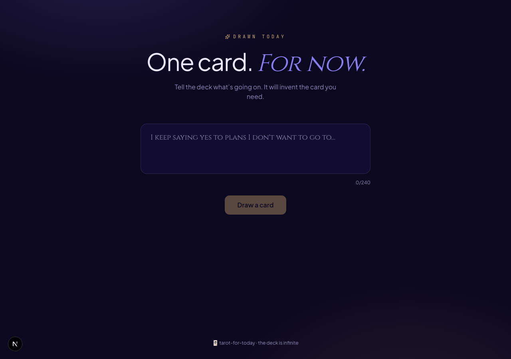

# 🃏 Tarot for Today

> One card. For now.

Tell the deck what&rsquo;s going on. It invents the card you need — a custom name, glyph, meaning, and one concrete thing to do today. Cozy mysticism, no horoscope cringe. Downloadable as a designed tarot card.

## Stack

- Next.js 15 · App Router · TypeScript
- Tailwind CSS v4 (`@theme`)
- OpenAI `gpt-4o`
- `html-to-image`
- Framer Motion · lucide-react
- Cinzel · Plus Jakarta Sans · JetBrains Mono

## Setup

```bash
pnpm install
cp .env.example .env.local
# add your OPENAI_API_KEY
pnpm dev
```

Open http://localhost:3000.

## License

MIT


